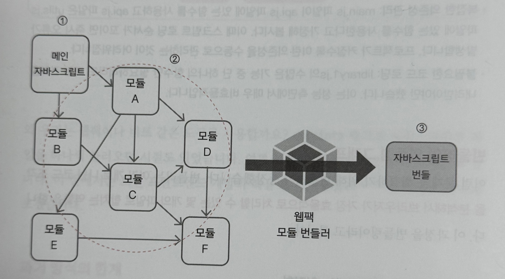

### Q90 프로젝트 빌드와 배포가 무엇인가요?

---

#### **책을 읽기 전 혼자 답해보기**

> 빌드는 깃에 올려 합치기 전 코드에 문제가 없는지 확인하는 과정이고 배포는 그 결과물을 사용자들이 사용할 수 있도록 하는 것이다.

#### 책정리

**프론트엔드에서의 지속적 통합과 지속적 배포**

빌드와 배포는 단순히 코드를 서버에 올리는 행위가 아니라, 코드를 작성한 순간부터 사용자에게 전달되기까지 전 과정을 자동화하는 `개발 조립 라인`을 구축하는 일이다.

- 지속적 통합(CI): 여러 개발자가 작성한 코드를 깃과 같은 중앙 저장소에 통합할 때마다, 자동으로 코드 품질을 검사하고 테스트하는 과정이다. 프론트엔드 관점에서는 ESLint로 코딩 컨벤션을 검사하고 Jest나 Vitest로 컴포넌트 기능 오류를 확인하는 단계가 여기에 해당한다. 즉, 버그가 있는 코드가 통합되는 것을 조기에 막아주는 품질관리 단계이다.
- 지속적 배포(CD): 지속적 통합을 통과한 코드를 자동으로 빌드하여 실제 서버에 배포하는 과정이다. 리액트나 뷰 코드를 브라우저가 이해할 수 있는 최적화된 파일 묶음인 build나 dist 폴더로 만들고 이를 사용자가 접근할 수 있는 서버로 옮긴다. 즉, 검수를 마친 제품을 자동으로 포장해 시장에 내놓는 출시 단계이다.

프론트엔드 CI/CD는 복잡하고 반복적인 빌드와 테스트, 배포 작업을 자동화하여 개발 생산성을 높이고 휴먼 에러를 방지하며 최종 결과물의 품질을 일관되게 유지하는데 목적이 있다.

**프론트엔드 개발자를 위한 CI/CD 도구**

| 구분 | 깃허브 액션 | 버셀/네트리파이 |
| --- | --- | --- |
| 개념 | • 범용 CI/CD 도구<br>• 클라우드 서버(AWS, GCP) 등에 직접 배포 로직을 구성할 때 주로 사용 | • **프론트엔드 특화** 배포 플랫폼<br>• 깃 저장소 연결만으로 CI/CD가 거의 완성됨 |
| 설정 | .yml 파일을 통해 빌드, 테스트, 배포 스크립트를 **직접 상세하게 작성**해야 함 | 플랫폼에 깃 저장소를 연결하면 프레임워크를 **자동 감지**하여 최적의 빌드, 배포 설정을 제공 |
| 장점 | • 커스터마이징 자유도가 매우 높음<br>• AWS S3, EC2 등 특정 인프라에 배포해야 할 때 유연함 | • **설정이 압도적으로 간편함**(Zero Config 지향)<br>• PR마다 **미리보기 URL** 자동 생성<br>• 글로벌 CDN이 기본 내장되어 배포 속도가 빠름 |
| 단점 | • 배포 스크립트, 인프라 관리에 대한 학습이 필요함 | • 정해진 환경 외의 복잡한 커스터마이징 요구 사항을 반영하기 어려움 |

**도커를 이용한 CI/CD**

도커는 앱 실행에 필요한 모든 파일을 컨테이너라는 표준화된 공간에 담아 포장하고 실행하는 기술이다. 

코드, 라이브러리, 설정 등 앱 실행에 필요한 모든 것을 도커 컨테이너에 담으면 내 노트북, 동료의 PC, 클라우드 서버 등 도커가 설치된 어느 환경에서든 똑같이 실행된다. 이 덕분에 개발 과정에서 자주 발생하는 환경 차이 문제를 깔끔하게 해결할 수 있다.

**도커 작업 단계**

도커 이미지를 만들 때 빌드에만 필요한 무거운 라이브러리까지 최종 이미지에 포함하면 용량이 불필요하게 커진다. 이를 해결하기 위해 사용하는 방법이 멀티 스테이지 빌드이다. Dockerfile 파일 안에 여러 개의 스테이지를 나누고 최종 단계에는 꼭 필요한 결과물만 포함하도록 구성한다. 

1. Dockerfile 파일을 생성한다. 그리고 앱을 빌드하는 전용 스테이지를 만든다. Node.js, npm 개발 의존성 등 빌드에 필요한 모든 도구가 이 단계에 포함되지만 최종 이미지에는 그대로 포함되지 않는다. 
2. 실제 서비스에 필요한 최소 환경만 포함하는 실행 스테이지를 작성한다. 

#### 모의 면접

Q1: 프론트엔드 개발에서 CI와 CD가 각각 담당하는 역할은 무엇이며 이를 자동화했을 때 얻을 수 있는 이점은 무엇인가요? 

> CI는 지속적 통합으로 개발자가 깃 저장소 같이 코드를 합치는 통합 저장소에 코드를 올릴 때 해당 코드의 코드 품질을 검사하고 테스트하는 과정이다. CD는 CI를 통과해 하나로 합쳐진 코드들을 사용자가 사용할 수 있는 서버로 올리는 일을 한다.  
> CI/CD를 자동화 했을 때 개발자는 일일이 스크립트를 돌려가며 확인하지 않아도 되고 깃에 코드를 push하기만 하면 되기에 개발 효율성이 상승한다.

Q2: 도커 멀티 스테이지 빌드를 활용하면 어떤 문제를 해결할 수 있으며 최종 배포 이미지가 어떻게 개선되나요?

> 도커 이미지를 만들 때 빌드에만 필요한 무거운 라이브러리까지 최종 이미지에 포함하면 용량이 불필요하게 커지게 되는데 이때 멀티 스테이지 빌드를 통해 해결할 수 있다.  
> 앱을 빌드하는 전용 스테이지에는 Node.js, npm 개발 의존성 등 빌드에 필요한 모든 도구가 포함된다. 하지만 실제 실행 스테이지에는 실제 서비스에 필요한 최소 환경만 포함된다. 이로 인해 용량이 획기적으로 줄어든다.

---

### Q92 번들러를 사용하는 이유는 무엇인가요?

---

#### **책을 읽기 전 혼자 답해보기**

> 브라우저는 리액트 코드를 이해할 수 없어서 번들러가 변환해줘야 하기 때문에..?

#### 책정리

**과거 방식의 한계**

과거에는 웹 사이트를 만들 때 다음과 같이 코드를 작성했다.

```html
<html>
<head>
	<title>굿</title>
</head>
<body>
<script src="js/library1.js"></script>
<script src="js/library2.js"></script>
<script src="js/library3.js"></script>
</body>
</html>
```

간단해 보이지만 여기에는 심각한 문제가 숨어있다.

- **네트워크 병목 현상:** 브라우저는 `<script>` 태그를 만날 때마다 서버에 파일을 요청한다. 파일이 10개면 10번, 100개면 100번의 HTTP 요청이 발생한다. 각 요청에는 보이지 않는 지연 시간이 존재한다.
- **복잡한 의존성 관리:** main.js 파일이 api.js 파일에 있는 함수를 사용하고 api.js 파일은 utils.js 파일에 있는 함수를 사용한다고 가정해보자. 이때 스크립트 로딩 순서가 꼬이면(defer 속성을 추가하면 어떻게 되려나) 즉시 오류가 발생하고 프로젝트가 커질수록 이런 의존성을 수동으로 관리하는 것이 어려워진다.
- **불필요한 코드 로딩:** library1.js의 수많은 기능 중 단 하나의 함수만 필요하더라도 파일 전체를 내려받아야 한다. 이는 성능 측면에서 매우 비효율적이다.

**번들러와 의존성 그래프**

이런 문제를 해결하기 위해 번들러가 등장했다. 번들러는 `여러 개로 나뉜 코드 조각을 분석해서 브라우저가 가장 효율적으로 처리할 수 있는 몇 개의 파일로 합치는 역할`을 한다.

**번들링 과정에서 이루어지는 최적화**

번들러는 단순히 파일을 합치기만 하는 것이 아니라 성능을 극대화하기 위한 다양한 최적화 작업을 수행한다.

- **번들링:** 여러 개의 자바스크립트와 CSS 파일을 하나 또는 소수의 파일로 병합한다. 이 작업은 HTTP 요청 수를 줄여서 네트워크 병목 현상을 완화하고 초기 로딩 속도를 크게 향상한다.
- **트랜스파일링:** 최신 자바스크립트 문법이나 JSX를 구형 브라우저도 이해할 수 있는 ES5 문법으로 변환한다. 바벨과 같은 도구를 활용할 수 있다. 이 작업은 직접적인 속도 향상보다는 안정성에 기여하며 더 많은 사용자가 문제없이 서비스를 이용할 수 있도록 만드는 과정이다.
- **코드 최소화:** 코드 동작에 영향을 주지 않는 공백, 주석, 줄 바꿈 등을 모두 제거하고 변수명을 짧게 바꿔 파일 크기를 줄인다. 파일 크기가 줄어들면 내려받는 시간이 줄어들고 사용자는 더 빠르게 콘텐츠를 볼 수 있게 한다.
- **코드 분할:** 거대한 번들 파일 하나 대신, 당장 필요한 코드와 나중에 필요한 코드를 분리한다. 초기 화면에 필요한 최소한의 코드만 먼저 불러오고 사용자가 특정 페이지로 이동하거나 기능이 실행할 때 나머지 코드를 동적으로 불러온다. 이를 지연 로딩이라고 한다.

**번들러의 의존성 그래프**

그렇다면 번들러는 어떻게 이런 최적화를 이루며 동작할까? 번들러의 핵심은 의존성 그래프(dependency graph)를 만드는 것이다.



① **진입점 설정**: 번들러에 프로젝트의 시작점이 되는 파일을 알려 준다.  
② **의존성 분석**: 번들러는 해당 파일을 읽고 import나 require 같은 키워드를 통해 어떤 모듈이 필요한지 파악한다.  
③ **그래프 완성**: 연결된 모든 모듈을 연쇄적으로 따라가며 프로젝트 전체의 코드 관계도를 완성한다. 마치 가족 관계도를 그리듯 말이죠. 이렇게 완성된 그래프를 바탕으로 번들러는 최종 결과물을 만들어 낸다.

#### 모의 면접

Q1: 번들러가 없던 시절에는 네트워크 병목, 의존성 관리, 불필요한 코드 로딩 문제를 각각 어떻게 해결했나요?  

> 해결하지 못함. 이걸 해결하기 위해서 번들러가 나옴

Q2: 웹팩과 비트의 개발 환경과 설정 방식의 차이는 무엇이며 각각 어떤 상황에 더 적합할까요?

> 웹팩은 이미 오랜 시간 다양한 환경에서 검증을 마친 번들러이다. 수많은 로더와 플러그인을 통해 이미지, 글꼴, CSS 등 거의 모든 종류의 자원을 처리할 수 있다. 하지만 코드를 수정할 때마다 전체 의존성 그래프를 다시 분석하고 번들링하는 과정을 거치므로 규모가 큰 프로젝트에서는 개발 서버 실행 속도와 코드 수정 반영이 느려질 수 있다. 또한 다양한 기능을 지원하는 만큼 초기 설정이 복잡할 수 있다.  
> 
> 비트는 웹팩과 달리 개발 환경에서 모든 파일을 미리 번들링하지 않고 브라우저가 기본적으로 지원하는 ES 모듈을 활용해 요청된 파일만 즉시 변환해서 전달한다. 그렇기 때문에 개발 서버 구동과 코드 수정 반영이 거의 즉각적으로 이루어진다. 대부분의 설정이 기본적으로 내장되어 있어 간단하게 시작할 수 있다.

---

### Q97 프론트엔드에서 사용하는 TDD 기법을 설명할 수 있나요?

---

#### **책을 읽기 전 혼자 답해보기**

> TDD는 Test Driven Development로 개발을 시작할 때 테스트를 먼저 작성하고 해당 테스트를 통과하도록 코드를 작성하는 것을 의미하며 Jest, Vitest, RTL, E2E 등 다양한 테스트 도구들이 존재한다.

#### 책정리

**TDD의 핵심 주기**

TDD란 `실제 프로덕션 코드를 작성하기 전에 실패하는 테스트 케이스를 먼저 작성하는` 개발 방식이다.

TDD는 3단계의 짧은 주기를 반복하며 진행되는데 이를 Red-Green-Refactor 사이클이라고 부른다. 

##### 1. RED - 실패하는 테스트를 작성하라

새로운 기능을 추가하거나 기존 기능을 수정하기 전에 먼저 그 기능이 어떻게 동작해야 하는지를 정의하는 테스트 코드를 작성한다. 이 시점에는 실제 기능 구현 코드가 없으므로 테스트가 반드시 실패해야 한다. 테스트 결과가 실패(Red)로 나오는 것을 확인하는 것이 첫 단계 목표이다.

##### 2. GREEN - 코드를 동작하게 하라

이제 실패한 테스트를 통과시키기 위한 `가장 최소한의 프로덕션 코드를 작성`한다. 여기서 중요한 것은 최소한의 코드라는 점이다. 일단 테스트만 통과시키는 것을 목표로 하므로 코드가 비효율적이거나 지저분해도 괜찮다. 

##### 3. REFACTOR - 코드를 개선하라

테스트가 통과하는 것을 확인했으니 이제 안심하고 코드의 품질을 높일 차례이다. 작성했던 프로덕션 코드의 중복을 제거하고 가독성을 높이며, 구조를 개선하는 리팩토링을 진행한다. 이 과정에서 기존의 테스트는 계속 통과해야 한다. 이는 코드를 개선하다가 기존 기능을 망가뜨리지 않았다는 것을 보장해준다.

이 Red-Green-Refactor 사이클을 아주 작은 단위로 빠르게 반복하며 소프트웨어의 기능을 점진적으로 완성해 나가는 것이 TDD의 핵심이다. 

**TDD의 주요 기법**

프론트엔드에서 TDD는 주로 UI 컴포넌트와 사용자 상호작용을 중심으로 이루어진다. 화면에 무엇이 보이고 사용자의 행동에 따라 어떤 변화가 일어나는지를 검증하는 것이 핵심이다. 이를 위해 사용하는 주요 기법은 다음과 같다. 

- 컴포넌트 렌더링 테스트: 특정 컴포넌트가 주어진 props에 따라 의도한 대로 화면에 잘 그려지는지 테스트한다.
- 사용자 이벤트 시뮬레이션: 사용자가 버튼을 클릭하거나 폼에 텍스트를 입력하는 등의 행동을 코드로 시뮬레이션하고, 그 결과로 상태나 UI가 예상대로 변경되는지 검증한다.
- 상태 관리 로직 테스트: Redux, Zustand 등 상태 관리 라이브러리의 로직을 검증한다. 특히 Reducer, Action 같은 순수 함수가 입력값에 따라 예측할 수 있게 동작하는지 테스트한다.

**TDD의 테스트 도구**

**테스트 러너와 프레임워크**

테스트 러너와 프레임워크는 테스트를 실행하고 결과를 관리해주는 도구이다.

- Jest
- Vitest

**테스팅 라이브러리**

테스팅 라이브러리는 UI 컴포넌트를 실제 사용자 관점에서 테스트 하도록 도와주는 도구이다.

- 리액트 테스팅 라이브러리
- 뷰 테스트 유틸

**E2E 테스트 도구**

E2E 테스트 도구는 단위 테스트보다 더 큰 범위의 사용자 시나리오를 검증하는 도구이다. TDD의 작은 단위 테스트와는 성격이 조금 다르지만, 전체 흐름을 보장하는데 매우 중요하다.

#### 모의 면접

Q1: TDD의 핵심 주기인 Red-Green-Refactor는 각각 어떤 의미를 가지며 왜 이 순서로 진행될까요? 

> Red는 실패, Green은 성공, Refactor는 개선  
> Red는 테스트를 실패하도록 작성하는 것, Green은 그 테스트를 최소한의 코드만으로 통과하게 하는 것, Refactor는 코드의 중복을 제거하고 개선하면서 테스트를 통과하도록 하는 것. 이때 기존의 테스트 역시 통과해야 함.

Q2: 프론트엔드에서 TDD를 적용할 때 자주 사용하는 테스트 도구(제스트, 테스팅 라이브러리, 사이프레스 등)의 역할 차이는 무엇인가요?

> 각각 목적과 테스트의 범위가 다르다.  
> 
> Jest, Vitest는 테스트 프레임워크로써 테스트를 실행하고 관리해주는 도구이다. 테스팅 라이브러리는 UI 컴포넌트를 실제 사용자 관점에서 테스트하도록 도와주는 도구이다. 사이프레스는 단위 테스트보다는 더 큰 통합 테스트에 가까우며 사용자 시나리오를 검증하는 테스트 도구이다.